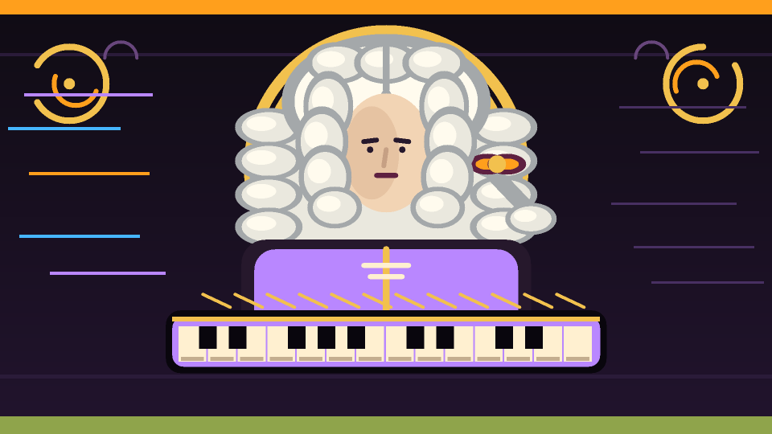

# BAR-ROCK



A polyphonic harpsichord for [VIBE FM](https://github.com/Vibe-FM-SDK/vibe-fm-sdk): sixteen Karplus-Strong voices, two slightly detuned 8' choirs, a cheap two-pole soundboard, a fixed-memory Schroeder stereo reverb, thirty-two registrations in two banks, and a bar-fly-derived colour rack. Keys and MIDI play immediately; F3/PLAY starts a 12-second excerpt of the supplied Dido's Lament MIDI. No setup, no samples and no impulse responses. The DSP is fixed-voice and allocation-free — no malloc, no heap and no libc maths in the audio path.

## Sound

- **16 voices** of plucked Karplus-Strong strings, with voice stealing when all are in use.
- **Two 8' choirs** per voice: A at the note frequency, B detuned by a few cents, each panned slightly left / right.
- **String voicing:** brightness (lowpass blend), damping and per-note velocity; natural decay or fast damping on note off.
- **Soundboard:** two one-pole resonators add a little body without an IR.
- **Reverb:** four damped combs plus two allpasses per channel, all in fixed arrays; a `Reverb` knob sets the wet amount and each registration carries its own room.
- **Colour rack:** solid/tube distortion, a clean-room dual-rotor Leslie, four-stage phaser, two-tap stereo chorus, flanger, tremolo, auto-pan, ring modulation, lo-fi crush and ping-pong/tape echo. The rack is a straight bypass when all amounts are zero.
- **32 registrations in two banks of 16:**
  - **CLEAN (1–16):** `8 + 8`, `WIDE 8`, `CLOSE 8`, `BRIGHT 8`, `DARK 8`, `SOLO A`, `SOLO B`, `LONG 8`, `SOFT 8`, `PLUCK`, `AIR 8`, `DEEP 8`, `DRY 8`, `WET 8`, `SHIMMER`, `TUTTI`. Only voicing, soundboard and reverb — the effects rack is a true bypass.
  - **FX (17–32):** the same voices with `FX 8+8` … `FX TUTTI`, each carrying a curated rack scene. Detailed FX rates and depths stay where the player left them. Pads 1–16 select a slot in the current bank; F2/F4 and encoder B browse all 32.
- **On-device demo:** F3 / PLAY plays a 12-second Dido excerpt from a generated, fixed C header. It uses both 8' stops and **loops by default** for hands-free FX testing; turn `Demo Loop` off on the SYSTEM page (or with the editor's `loop` button) for a single pass. F3 again or PANIC always stops it.
- Raw MIDI note-on/off, VIBE keys, DAW notes and the custom Editor keyboard all feed the same voice allocator.

## FX rack

The rack follows the harpsichord reverb. Every CLEAN registration leaves it at zero (a straight bypass); FX-bank registrations switch on a small curated scene, and the player can still adjust every detail. All mixes/depths are smoothed per block to avoid zipper noise and clicks.

- **DRIVE:** solid or asymmetric tube saturation, drive, lo-fi crush and ring modulation.
- **ROTARY:** Leslie on/off, stop / slow / fast motors, Doppler depth and horn drive.
- **MOD:** phaser mix/rate and chorus mix/rate.
- **COLOUR:** flanger, tremolo, auto-pan and the horn/bass microphone balance.
- **ECHO:** ping-pong or tape echo with mix, time (80–240 ms) and feedback.

The Leslie is bar-fly's clean-room dual-rotor model: separate horn and bass motors with spin-up/coast ramps, three geometry-based baffle taps per rotor and a stereo mic mix. No samples, no IRs and no heap — the whole rack lives in fixed arrays.

## Controls

| Control | Action |
|---|---|
| Keys / MIDI / DAW notes | Play the harpsichord (16 voices) |
| Pads 1–16 | Select a slot in the current bank (CLEAN or FX) |
| SOUND page / Bank knob | Switch between the CLEAN and FX banks |
| F1 / Encoder A | Next page |
| F2 / Encoder B | Next registration (crosses 16→17 and wraps 32→1) |
| F3 / PLAY | Play or stop the 12-second Dido snippet |
| SYSTEM knob 2 / editor `loop` button | Demo Loop on (default) repeats the snippet; off plays it once |
| F4 | Previous registration (crosses banks) |
| F5 / HOME / K5 | Show the controls overview |
| F6 / K6 / REC / STOP | Panic (all notes off) |
| K1–K4 | SOUND / STRINGS / STOPS / FX (press K4 again to step through FX pages) |
| Knobs 1–4 | Edit the four values shown |
| F1 / Encoder A | Cycle SOUND, STRINGS, STOPS, DRIVE, ROTARY, MOD, COLOUR, ECHO, SYSTEM |
| Reverb knob | On STRINGS / SYSTEM; sets the algorithmic room amount |
| Editor FX buttons | Toggle the Leslie and cycle distortion type; all rack knobs are on FX / SPACE tabs |
| DATA + ENTER | FOCUS: walk the controls, press to edit (hold ENTER 0.6 s) |

The firmware stays fully playable from the device and the standard Editor. The optional custom Editor page adds a keyboard, registration buttons and the device display.

## Build

Requires Zig 0.13.0 on `PATH`, `sh`, Node.js (for validation) and Python 3 (for the icon and packaging).

```sh
# If the vendored SDK is missing, fetch the pinned commit:
sh scripts/fetch-sdk.sh

# Build the WASM + ZIP:
cd sdk
sh tools/build.sh ../firmware/bar-rock
# -> build/bar-rock.wasm, build/bar-rock.zip, build/bar-rock.json,
#    build/bar-rock.png, build/bar-rock.editor/
```

Windows:

```powershell
pwsh -File scripts/build.ps1
```

Regenerate the icon:

```sh
python tools/make_icon.py
```

## Validate

```sh
node sdk/tools/vibe-check.mjs sdk/build/bar-rock.wasm \
  --manifest firmware/bar-rock/firmware.json --seconds 5

mkdir -p sdk/build/bar-rock-test
node sdk/tools/wasmtest.mjs sdk/build/bar-rock.wasm \
  firmware/bar-rock/wasmtest.json sdk/build/bar-rock-test

mkdir -p sdk/build/bar-rock-midi-test
node sdk/tools/wasmtest.mjs sdk/build/bar-rock.wasm \
  firmware/bar-rock/wasmtest-midi.json sdk/build/bar-rock-midi-test

mkdir -p sdk/build/bar-rock-snippet
node sdk/tools/wasmtest.mjs sdk/build/bar-rock.wasm \
  firmware/bar-rock/wasmtest-snippet.json sdk/build/bar-rock-snippet

mkdir -p sdk/build/bar-rock-fx
node sdk/tools/wasmtest.mjs sdk/build/bar-rock.wasm \
  firmware/bar-rock/wasmtest-fx.json sdk/build/bar-rock-fx
```

Browser emulator: `python3 sdk/tools/emulator.py` → `http://127.0.0.1:8766`.

## Baroque demo

The demo source is `firmware/bar-rock/demo/2465dido.mid`, a supplied MIDI sequence of Purcell's
"Dido's Lament" (track metadata credits Emily Gray for the sequence). It is playable in any DAW
with BAR-ROCK as the instrument; `wasmtest-demo.json` is generated from that file and renders the
same notes through the firmware, including the source tempo map. The same generator also writes
`demo_snippet.h`, a 12-second middle-section excerpt that the firmware plays from F3 / PLAY
without any file access.

```sh
python tools/make_demo.py            # regenerate the render script and on-device snippet
mkdir -p sdk/build/bar-rock-demo
node sdk/tools/wasmtest.mjs sdk/build/bar-rock.wasm \
  firmware/bar-rock/wasmtest-demo.json sdk/build/bar-rock-demo
```

See `firmware/bar-rock/demo/README.md` for details.

## Deploy

Drop `sdk/build/bar-rock.zip` onto the VIBE FM VST window in your DAW, or load `bar-rock.wasm` in the SDK emulator / on VIBE FM hardware.

## Layout

```
firmware/bar-rock/
  main.c                  parameters, keys/pads, display, editor bridge, state
  harpsi.c / harpsi.h     the Karplus-Strong engine (16 voices, 2 choirs, soundboard, reverb)
  fx.c / fx.h             fixed-memory colour rack (drive, Leslie, modulation, echo)
  registrations.h         32 factory registrations: 16 CLEAN + 16 FX scenes
  firmware.json           manifest (id: bar-rock, protocol 7)
  editor/index.html       optional custom Editor page
  icon.png                960 x 540 menu tile (Baroque powdered-wig portrait)
  wasmtest.json           scripted audio/display regression
  wasmtest-midi.json      raw MIDI note on/off regression
  demo_snippet.h          generated 12 s note list for the DEMO button
  wasmtest-demo.json      scripted Baroque demo render
  wasmtest-snippet.json   scripted DEMO-button regression
  wasmtest-fx.json        scripted full-rack / bypass / Leslie regression
  wasmtest-bank.json      scripted CLEAN / FX bank-switch regression
  wasmtest-loop.json      scripted looping-demo wrap regression
  demo/                   Dido's Lament MIDI + notes
patches/                  (none — registrations live in registrations.h)
tools/make_icon.py        stdlib-only icon generator
tools/make_demo.py        stdlib-only MIDI-to-wasmtest/snippet generator
scripts/                  SDK fetch + Windows build wrapper
sdk/                      vendored VIBE FM SDK (pinned commit)
.github/workflows/        CI: build, vibe-check, wasmtest, artifact
```

## Credits

Built with the VIBE FM SDK (Apache-2.0). The harpsichord engine is an original compact implementation of Karplus-Strong string synthesis adapted to the SDK's realtime, allocation-free rules. The colour rack is adapted from the clean-room DSP in the companion BAR-FLY firmware (Apache-2.0); it uses no third-party effect code and no impulse responses. "VIBE FM" is a trademark of its respective owner; this firmware is built with the VIBE FM SDK and is not affiliated with or endorsed by the trademark holder.
